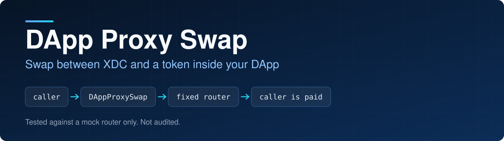
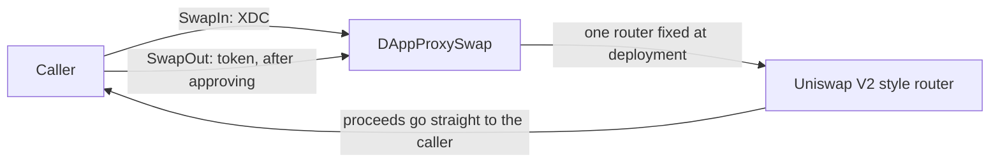

<p align="center">
  
</p>

<p align="center">
  
<a href="https://github.com/CoinClubQuincy/DAppProxySwap/actions/workflows/build.yml"></a>        
</p>

<p align="center">
  <a href="#how-it-works">How it works</a> · <a href="#try-it">Try it</a> · <a href="#what-is-tested">What is tested</a> · <a href="#known-issues">Known issues</a>
</p>

A DApp may need one currency while its user holds another. This contract swaps XDC for a token, or a token for XDC, through one fixed router that uses the Uniswap V2 interface. A DApp can use it to take payment in the right currency, and a user can use it to turn a volatile token into a stable one when taking funds out.

> [!CAUTION]
> This contract has **only been tested against a mock router**. It has never been run against a real DEX or on a real network, and it has not been audited. See [Known issues](#known-issues).

## How it works



| Function | What it does |
| --- | --- |
| `constructor(router)` | Fixes the router for the life of the contract |
| `SwapIn(token, minOut, deadline)` | Swaps the XDC you send for a token |
| `SwapOut(token, total, minOut, deadline)` | Swaps your tokens for XDC. Approve this contract first |

What protects the caller:

- **Slippage.** You choose `minOut`, and zero is refused. Work it out off-chain from a price you trust. `SwapIn` checks the amount that reached your address, not the figure the router reports.
- **Expiry.** You choose `deadline`, so a stuck transaction cannot run much later at a worse price.
- **No caller-chosen router or path.** The router cannot be swapped for a malicious one in the call, and the path is always directly between the token and wrapped XDC.
- **Your funds only.** The contract moves tokens only from the caller, and pays only the caller.
- **No leftover allowance.** The router's allowance goes back to zero after each swap.

## Try it

```bash
git clone https://github.com/CoinClubQuincy/DAppProxySwap.git
cd DAppProxySwap
git clone --depth 1 -b v4.9.6 https://github.com/OpenZeppelin/openzeppelin-contracts lib/openzeppelin-contracts
git clone --depth 1 -b v1.9.7 https://github.com/foundry-rs/forge-std lib/forge-std
forge test
```

You need [Foundry](https://getfoundry.sh).

To try it on a network, use the Apothem testnet:

| Network | Chain ID | RPC |
| --- | --- | --- |
| Apothem testnet | 51 | `https://rpc.apothem.network` |
| XDC mainnet | 50 | `https://rpc.xinfin.network` |

```bash
forge create contracts/proxySwap.sol:DAppProxySwap --rpc-url https://rpc.apothem.network --interactive --broadcast --legacy \
  --constructor-args 0xYourRouterAddress
```

## What is tested

[`test/foundry/ProxySwap.t.sol`](test/foundry/ProxySwap.t.sol) has 16 tests, including one fuzz test, and runs in CI on every push.

| Tested | Not tested |
| --- | --- |
| Both swap directions paying the caller, against a mock router | A real router or real liquidity |
| The minimum and deadline reaching the router, and zero or expired values being refused | A real network, testnet or mainnet |
| Spending another user's approval being refused | An independent security audit |
| No allowance left behind, and direct payments and fee tokens being refused | Whether Globiance, XSwap or any other DEX behaves like the mock |
| A token that tries to swap again during a transfer | |
| Fuzz: nothing is left in the contract after swaps | |

## Changes from earlier versions

Contracts already deployed are unaffected, though the earlier functions were all empty and did nothing.

- `DAppProxySwap` was implemented, and its functions now take a minimum output and deadline.
- The empty `GlobianceProxySwap`, `XSWAPProxySwap`, `SWIFTAllChainBridgeProxySwap`, `ImpelProxySwap` and `WanChainProxySwap` contracts were removed. Deploy `DAppProxySwap` with a compatible router for a DEX. The bridges and the planned choice between DEXes were never built, and are not built now.
- `SwapIn` now measures what actually arrived, checks it against `minOut`, and reports that figure.
- The unused Hardhat package files were removed.

## Known issues

| Issue | Effect |
| --- | --- |
| Whoever deploys chooses the router | A deployment pointing at a malicious router could steal swaps. Only use a deployment whose router you have checked |
| Only direct pairs | A token with no direct pool against wrapped XDC cannot be swapped |
| Fee tokens are refused | Tokens that take a fee on transfer are not supported |
| Tokens sent directly are stuck | There is no owner and no way to recover them |
| Malicious tokens | Any token address can be passed. It can only affect the caller who chose it, but check it first |

## Third-party code

[`contracts/RouterV2.flat.sol`](contracts/RouterV2.flat.sol) is a flattened copy of Uniswap V2 style interfaces and helpers from [Globiance](https://dex.globiance.com/). It has no license header, and it was left unchanged. It is not covered by the license below.

<details>
<summary><strong>More XDC and EVM projects</strong></summary>

| Group | Project | What it is |
| --- | --- | --- |
| Standards | [XRC-SHARES](https://github.com/CoinClubQuincy/XRC-SHARES) | Dividend-paying NFT shares and SPLITS for a DApp |
| Standards | [XRCDividendPlus](https://github.com/CoinClubQuincy/XRCDividendPlus) | Dividend-paying XRC-20 token |
| Treasury and finance | [Multi-Sig-Treasury](https://github.com/CoinClubQuincy/Multi-Sig-Treasury) | Treasury controlled by tokenized keys |
| Treasury and finance | [XRC-Airdrop](https://github.com/CoinClubQuincy/XRC-Airdrop) | Self-run token airdrop |
| Treasury and finance | [XRC-Credit](https://github.com/CoinClubQuincy/XRC-Credit) | Single-loan credit contract |
| Treasury and finance | [XDC-Defi-Instruments](https://github.com/CoinClubQuincy/XDC-Defi-Instruments) | Assets, agreements, forwards, futures and a marketplace |
| Treasury and finance | [XRC1155-Equities-Market](https://github.com/CoinClubQuincy/XRC1155-Equities-Market) | Shares, portfolios and a marketplace on ERC-1155 |
| Treasury and finance | [NFTOTC](https://github.com/CoinClubQuincy/NFTOTC) | Over-the-counter sale of a token collection |
| Identity and access | [LoginMFAContract](https://github.com/CoinClubQuincy/LoginMFAContract) | Login with an NFT and a signed second factor |
| Identity and access | [PrivateAccessToken](https://github.com/CoinClubQuincy/PrivateAccessToken) | Token access to encrypted off-chain data |
| Identity and access | [Delegated_Authority](https://github.com/CoinClubQuincy/Delegated_Authority) | KYC notary proof of concept |
| Identity and access | [EncryptedNFT-Documents](https://github.com/CoinClubQuincy/EncryptedNFT-Documents) | NFTs tied to encrypted off-chain documents |
| Learning and libraries | [XDC-LemonadeStand](https://github.com/CoinClubQuincy/XDC-LemonadeStand) | Workshop DApp built on XRC-SHARES |
| Learning and libraries | [Non-Financial-SmartContracts](https://github.com/CoinClubQuincy/Non-Financial-SmartContracts) | Games, inventory, keys and on-chain repositories |
| Learning and libraries | [ContractLedger](https://github.com/CoinClubQuincy/ContractLedger) | On-chain list of contract addresses |
| Learning and libraries | [TimestampConverter](https://github.com/CoinClubQuincy/TimestampConverter) | Timestamps to calendar dates in Solidity |
| Tools | [XDC_Python_SDK_V1](https://github.com/CoinClubQuincy/XDC_Python_SDK_V1) | Python client for the XDC JSON-RPC API |
| Tools | [PrivateXDCNode_SetupScript](https://github.com/CoinClubQuincy/PrivateXDCNode_SetupScript) | Private XDC network setup scripts |
| Tools | [WebApp_to_XDCPay](https://github.com/CoinClubQuincy/WebApp_to_XDCPay) | Working web app connected to XDCPay |
| Multi-chain | [CoinClub_Framework](https://github.com/CoinClubQuincy/CoinClub_Framework) | Python library with an XDC adapter |
| Interfaces | [Contract_Interface_Model_Language](https://github.com/CoinClubQuincy/Contract_Interface_Model_Language) | Interface documents for smart contracts and APIs |

</details>

## License

[MIT](LICENSE), except for `contracts/RouterV2.flat.sol`. That file is flattened interface code from Globiance with no license header, so this license doesn't cover it.
